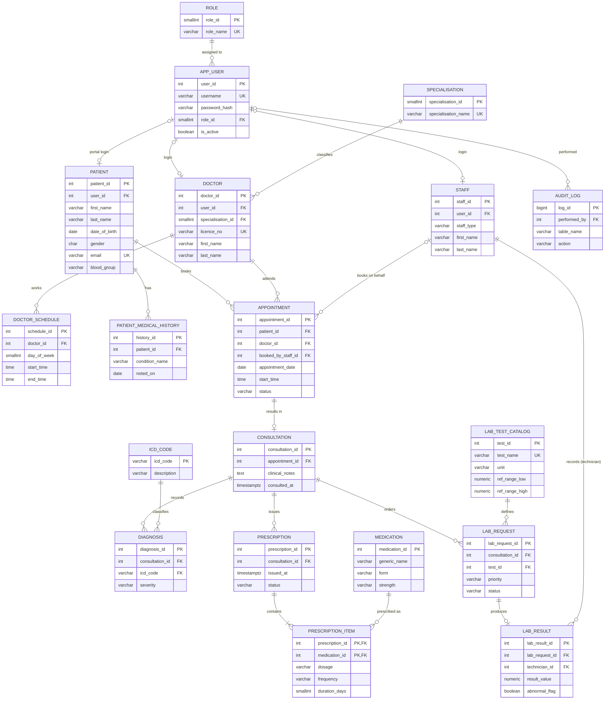

# ER Diagram: Ardeliah Clinical System

The diagram below is written in Mermaid, so GitHub renders it automatically. To get an image for the LMS submission, paste the code block into <https://mermaid.live> and export as PNG.

## Entities and what they hold

| Entity | Purpose |
|---|---|
| ROLE, APP_USER | Authentication and role-based access (patient, doctor, receptionist, lab technician, admin) |
| PATIENT, PATIENT_MEDICAL_HISTORY | Demographics, plus a one-to-many list of past conditions |
| SPECIALISATION, DOCTOR, DOCTOR_SCHEDULE | Doctor profiles and weekly working hours |
| STAFF | Receptionists and lab technicians (separated by `staff_type`) |
| APPOINTMENT | A patient booking a doctor for a date and time |
| CONSULTATION | What happened at a completed appointment, including clinical notes |
| ICD_CODE, DIAGNOSIS | Standard diagnosis codes and the diagnoses recorded per consultation |
| MEDICATION, PRESCRIPTION, PRESCRIPTION_ITEM | Electronic prescriptions with one line per drug |
| LAB_TEST_CATALOG, LAB_REQUEST, LAB_RESULT | Tests that can be ordered, requests made by doctors, results entered by technicians |
| AUDIT_LOG | Who changed what, used in the transaction exercises |

## Cardinality reasoning

- **Patient to Appointment is 1:N.** One patient can have many appointments over time, but each appointment is for exactly one patient.
- **Doctor to Appointment is 1:N**, with the extra rule that a doctor cannot hold two live appointments in the same slot. This is enforced by the partial unique index `uq_doctor_slot_active`.
- **Appointment to Consultation is 1:0..1.** An appointment only produces a consultation if the patient is actually seen, so cancelled and no-show appointments have none. The `UNIQUE` on `consultation.appointment_id` enforces the "at most one".
- **Consultation to Diagnosis, Prescription and Lab Request is 1:N** in each case. A doctor can record several diagnoses, issue several prescriptions and order several tests in one visit.
- **Prescription to Medication is M:N**, because a prescription can list several drugs and a drug appears on many prescriptions. It is resolved through the associative table `PRESCRIPTION_ITEM`, whose composite key is (`prescription_id`, `medication_id`).
- **Lab Request to Lab Result is 1:0..1.** A request has no result until the technician records one.
- **User accounts are optional for patients.** A walk-in patient can be registered by reception with no portal login, which is why `patient.user_id` is nullable.

## Assumptions

- The clinic is outpatient only, so there are no ward admissions or bed management.
- Billing and payments are outside the scope of this case study. The transaction exercises in Portfolio 3 use appointment booking with an audit entry instead.
- Each appointment is a fixed-length slot identified by its start time.

A pre-rendered image of the diagram above is in `er-diagram.png` (generated from this Mermaid source with the Mermaid CLI), for viewers that do not draw Mermaid.
