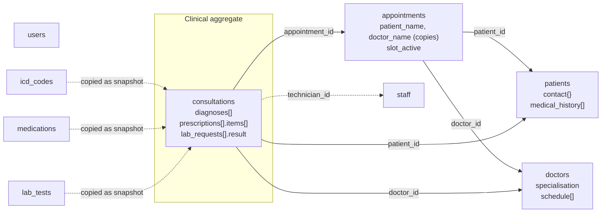

# NoSQL Model: Ardeliah Clinical System

## 1. Choice of model: document database (MongoDB)

The brief asks for one NoSQL type. I chose a **document database** and used **MongoDB** syntax (mongosh and the aggregation pipeline). The deciding observation is in the relational design from Portfolio 1: a doctor's visit produces a bundle of records (consultation, diagnoses, prescription, drug lines, lab requests, lab results) that are **created together, read together and almost never queried on their own**. In SQL that bundle is spread over six tables and has to be reassembled with joins every time it is displayed. A document model lets the bundle be stored as it is used.

The other types were considered and set aside:

| Type | Why not chosen for this case study |
|---|---|
| Key-value (Redis) | Fine for sessions or caching, but the clinic needs to query inside records (by diagnosis, by date, by status) |
| Column-family (Cassandra) | Suits very high write volume and known query patterns; a single outpatient clinic does not need that, and ad hoc clinical questions are awkward |
| Graph (Neo4j) | Good for relationships such as referral networks, but the main workload here is records, not relationships |

## 2. The model at a glance

Nine collections, down from 19 tables.



Solid arrows are references by id. Dotted arrows from reference collections are copies made at the time of the event, explained in section 4.

## 3. Embed or reference? The rules I applied

For each relationship I asked three questions:

1. **Are the two things read together almost every time?** If yes, lean towards embedding.
2. **Does the inner data grow without a limit?** If yes, do not embed (a document must stay small; MongoDB's limit is 16 MB per document).
3. **Is the inner data shared by many parents or changed independently?** If yes, reference it.

| Relationship | Decision | Reason |
|---|---|---|
| Patient and medical history | **Embed** | Always shown with the patient; a handful of entries |
| Patient and contact details | **Embed** | One-to-one, always together |
| Doctor and weekly schedule | **Embed** | At most about 7 entries; read with the doctor |
| Doctor and specialisation | **Embed the name** | A short string that rarely changes; saves a lookup everywhere |
| Consultation and diagnoses | **Embed** | Created with the visit, a few per visit |
| Consultation and prescriptions and drug lines | **Embed** (array inside an array) | Created with the visit and always displayed with it |
| Lab request and its result | **Embed** inside the consultation | One result per request, created later but belongs to that request |
| Patient and appointments | **Reference** | Grows for the life of the patient: unbounded |
| Patient and consultations | **Reference** (`patient_id` in the consultation) | Same reason; the patient document stays small |
| Appointment and consultation | **Reference** (`appointment_id`) | An appointment can exist without a consultation (cancelled, no-show) |
| ICD codes, medications, lab tests | **Reference collections, copied when used** | Shared lists, edited in one place |
| Users and passwords | **Separate collection** | Different security rules from clinical data |

## 4. Patterns used

- **Embedding (aggregate):** the consultation document is the unit of reading, writing and atomicity. A single `insertOne` stores a whole visit, and a single `updateOne` can record a lab result.
- **Extended reference:** an appointment stores `patient_id` and `doctor_id` **and** a copy of the two names, so the appointment list needs no lookups. The cost is that a name change would have to be copied; for names this is rare and acceptable.
- **Snapshot of reference data:** a prescription line stores the drug name, form and strength **as they were when prescribed** (`medication: { generic_name, form, strength }`), and a diagnosis stores the ICD description. This is deliberate. In a medical record, the history must show what was prescribed then, even if the catalogue is edited later. In the relational schema this is the trade-off in reverse: a foreign key always shows the current catalogue entry.
- **Flexible schema:** a patient without an email or blood group simply has no such field (walk-in patients), and a lab request without a result has no `result` field. Nothing is stored as an empty placeholder.
- **A flag for a partial index:** `slot_active` is true unless the appointment is cancelled. PostgreSQL could enforce "one live appointment per doctor and time" with a partial index on `status <> 'CANCELLED'`. MongoDB partial indexes cannot express "not equal", so the same protection uses an explicit flag, and cancelling must set both `status` and `slot_active`.

## 5. Mapping from the relational schema

| Relational tables (Portfolio 1) | Becomes |
|---|---|
| `patient`, `patient_medical_history` | `patients` (history embedded) |
| `doctor`, `specialisation`, `doctor_schedule` | `doctors` (schedule embedded, specialisation name copied) |
| `appointment` | `appointments` |
| `consultation`, `diagnosis`, `prescription`, `prescription_item`, `lab_request`, `lab_result` | `consultations` (all embedded) |
| `icd_code` | `icd_codes` |
| `medication` | `medications` |
| `lab_test_catalog` | `lab_tests` |
| `staff` | `staff` |
| `app_user`, `role` | `users` (role name stored as text) |
| `audit_log` | Not exported in this exercise. In production it would be its own collection, or better the MongoDB audit facility |

In the 303-patient sample, one visit's data is **9,759 rows in 6 relational tables** (2,161 consultations, 2,589 diagnoses, 1,269 prescriptions, 2,051 drug lines, 848 lab requests, 841 results) and **2,161 documents** in MongoDB. The export script `export-from-postgres.sql` does the transformation, and `verification/run-with-mingo.mjs` confirms that no data was lost (every count and every query result matches PostgreSQL; see `evidence/cross-check-postgres-vs-mongodb.md`).

## 6. A real consultation document

This is consultation 1, exported from the PostgreSQL data (the malaria case from the Portfolio 1 sample data). It shows an array of diagnoses, a prescription with two drug lines, and a lab request with its result, all in one document.

```json
{
  "_id": 1,
  "appointment_id": 1,
  "patient_id": 1,
  "doctor_id": 1,
  "consulted_at": { "$date": "2026-10-20T08:10:00Z" },
  "clinical_notes": "Febrile, temp 38.6C, no neck stiffness. Chills and bodyache. Malaria parasite test ordered.",
  "diagnoses": [
    { "icd_code": "B50.9", "description": "Plasmodium falciparum malaria, unspecified",
      "severity": "MODERATE", "notes": "Confirmed by MP test" }
  ],
  "prescriptions": [
    { "prescription_id": 1, "issued_at": { "$date": "2026-10-20T08:40:00Z" }, "status": "ISSUED",
      "items": [
        { "medication": { "generic_name": "Artemether/Lumefantrine", "form": "tablet", "strength": "20/120 mg" },
          "dosage": "4 tablets", "frequency": "twice daily", "duration_days": 3 },
        { "medication": { "generic_name": "Paracetamol", "form": "tablet", "strength": "500 mg" },
          "dosage": "2 tablets", "frequency": "every 6 hours as needed", "duration_days": 3 }
      ] }
  ],
  "lab_requests": [
    { "lab_request_id": 1, "test": { "name": "Malaria parasite (MP) count", "unit": "parasites/uL" },
      "priority": "URGENT", "status": "COMPLETED", "requested_at": { "$date": "2026-10-20T08:15:00Z" },
      "result": { "value": 2400, "abnormal": true, "comment": "P. falciparum trophozoites seen",
                  "recorded_at": { "$date": "2026-10-20T08:35:00Z" }, "technician_id": 2 } }
  ]
}
```

(`{"$date": ...}` is MongoDB Extended JSON for a date; in the database it is stored as a real BSON date.)

## 7. Validation (the equivalent of constraints)

`create-collections.js` attaches a `$jsonSchema` validator to the five main collections, which runs on every insert and update (`validationLevel: "strict"`, `validationAction: "error"`).

| Relational constraint | Document equivalent |
|---|---|
| `NOT NULL` | `required: [...]` |
| `CHECK (gender IN ('M','F','O'))` | `enum: ["M","F","O"]` |
| `CHECK (duration_days > 0)` | `minimum: 1` |
| Column data types | `bsonType` |
| `UNIQUE (email)` | Unique partial index on `contact.email` |
| One live appointment per doctor and time | Unique partial index on `slot_active: true` |
| `FOREIGN KEY` | **No equivalent.** MongoDB does not check that `patient_id` points at an existing patient |
| `CHECK (date_of_birth <= CURRENT_DATE)` | **No equivalent.** A validator cannot refer to the current date, so the application must check it |

## 8. Indexes

| Index | Serves |
|---|---|
| `patients (last_name, first_name)` | Reception search (Q1) |
| `patients (contact.email)` unique, partial | Unique email where one exists |
| `appointments (patient_id, scheduled_at desc)` | Patient's appointments (Q2) |
| `appointments (doctor_id, scheduled_at)` unique, partial on `slot_active: true` | Double-booking guard, and the doctor's week sheet (Q5) |
| `consultations (patient_id, consulted_at desc)` | Patient's clinical history (Q3) |
| `consultations (diagnoses.icd_code, consulted_at desc)` | Cases by diagnosis (Q9); a multikey index over the embedded array |
| `consultations (lab_requests.status, consulted_at)` | Laboratory work queue (Q10) |
| `users (username)` unique | Login |

**Not measured:** these indexes were not benchmarked or inspected with `explain()`, because no MongoDB server was available when this portfolio was prepared (see the README). Their definitions follow standard MongoDB usage but should be run and checked on a real server.

## 9. Assumptions and limits

- Targets MongoDB 6.0 or later; `$jsonSchema`, partial indexes and the aggregation stages used all exist in earlier versions as well.
- The export covers a sample of 303 patients to keep the repository small; the same script exports everything if `maxpid` is raised.
- Cross-collection rules (a lab technician must exist, an appointment must point at a real doctor) are not enforced by the database in this design.
