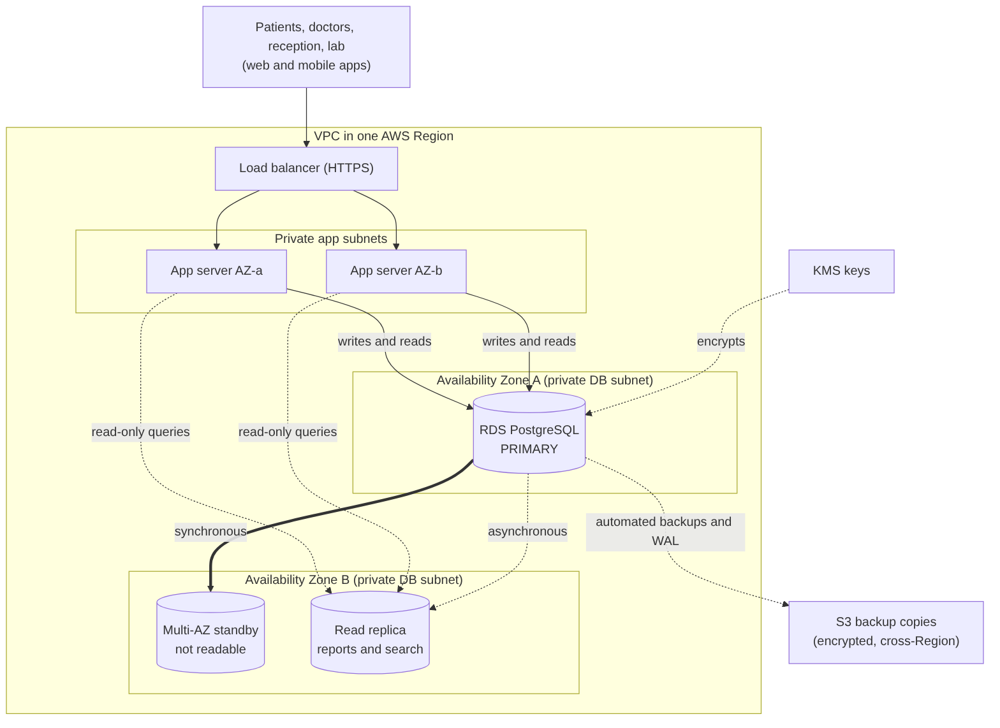

# Portfolio 5: Distributed Databases and Cloud Deployment

How the Ardeliah Clinical System could be replicated, partitioned and hosted on AWS, with two small real demonstrations on PostgreSQL.

> **Read this first.** Nothing was deployed to AWS. The cloud material is **design and discussion**. What is real: a PostgreSQL 16 streaming-replication run and a hash-partitioning run, both on one machine. See `cloud-deployment-evidence.md`.

| File | Purpose |
|---|---|
| `distributed-database-discussion.md` | Why distribute, replication, sharding options, CAP, availability, failure table, security, cost |
| `replication-sharding-strategy.md` | The chosen strategy, routing rules, failover steps, shard design, what is verified |
| `cloud-deployment-evidence.md` | Honest status, a plan for real AWS evidence, an evidence log to fill in |
| `architecture-diagram.mmd` / `.png` | Target AWS architecture (Multi-AZ primary and standby, read replica, backups, KMS) |
| `replication-lab/` | Scripts and real outputs of the local replication and partitioning demos |

## Architecture

Mermaid source: `architecture-diagram.mmd`.

## Key decisions

- Single writer with a **synchronous Multi-AZ standby** for availability, plus one **asynchronous read replica** for reports.
- Writes and safety-critical reads go to the primary: consistency before availability for clinical writes (CAP).
- **Shard by patient ID** only when one primary is measurably the bottleneck; reference tables are replicated everywhere.
- Encryption at rest and in transit, private subnets, least-privilege roles, tested restores.

## What to verify yourself

Re-run the local demos, check every AWS claim against the current AWS documentation, check Nigerian data-protection and hosting rules with a qualified person, and, if you can, produce real AWS evidence following section 2 of `cloud-deployment-evidence.md`.
